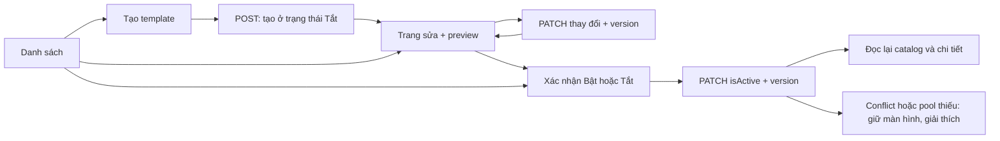

# Đề xuất Admin Daily Missions — đồng bộ Shop

Ngày: 2026-10-05. Trạng thái: đề xuất thiết kế, chưa triển khai UI/API và chưa thay đổi quyết định PO.

Cập nhật triển khai: UI/API client đã được xây dựng theo thiết kế này; xem [phạm vi, cách truy cập và giới hạn nghiệm thu](./admin_missions_implementation.md). Backend Admin API và quyết định PO vẫn chưa thay đổi. Trạng thái READY ở §9 là đánh giá thiết kế, không phải chứng nhận runtime.

## 1. Phạm vi và nguồn dữ liệu

Quản lý **catalog template** dùng để cấp Daily Missions, theo [daily_mission.md §8.3](../../../docs/decisions/daily_mission.md). Không quản lý mission riêng của từng người dùng.

Backend hiện chưa có endpoint Admin Mission Templates. Các endpoint dưới đây là contract trong spec, cần triển khai trước khi bật menu release. Prototype Missions cũ có trường và trạng thái khác contract; không dùng các type/mock đó làm nguồn dữ liệu cho UI mới.

Tham chiếu UI đang nối API: `src/features/shop/ShopEconomyPage.tsx`, `shop-list/ShopItemListPage.tsx`, `shop-editor/ShopItemEditorPage.tsx`, `components/ShopModals.tsx`; tham chiếu domain: `src/domains/shop`.

## 2. Các màn hình

### A. Danh sách template

Breadcrumb “Nhiệm vụ”; tiêu đề “Nhiệm vụ hằng ngày”; mô tả “Quản lý các mẫu nhiệm vụ dùng để cấp bộ nhiệm vụ cho người học”.

Toolbar cùng cấu trúc Shop: tìm tên/mã, lọc nhóm, lọc Bật/Tắt, Làm mới, **Tạo nhiệm vụ**. Danh sách spec không phân trang: tìm kiếm phía client; không gửi `q/page/size` cho endpoint Missions. Với catalog nhỏ, tải toàn bộ một lần rồi lọc local giúp luôn tính đúng trạng thái catalog.

Một dải thông tin gọn phía trên bảng: “Đang bật: N”, “Không cần điều kiện cấp: C”, “Invariant catalog: Đạt/Không đạt”. C ở đây chỉ đếm mẫu cốt lõi active có `NONE`, không đếm toàn bộ template NONE; ghi rõ phạm vi trong tooltip. Đây là số liệu từ catalog, không phải thống kê hiệu quả nhiệm vụ. Tính trên toàn bộ dữ liệu chưa lọc.

Tooltip invariant: “Chỉ kiểm tra invariant tối thiểu của catalog. Không đảm bảo mọi nhiệm vụ đều khả dụng cho mọi người học hoặc catalog đã sẵn sàng production.” `NONE` nghĩa là không có eligibility gate, không có nghĩa mọi learner làm được. Không gắn badge readiness/fairness tự động khi chưa có contract đánh giá theo learner.

| Cột | Nội dung |
| --- | --- |
| Nhiệm vụ | Tên đậm, mã nhỏ bên dưới; tên mở trang sửa |
| Nhóm | Badge nhãn tiếng Việt của category |
| Mục tiêu | Câu dễ đọc: “Hoàn thành 2 quiz · 5 câu/bài” |
| Phần thưởng | Coin, XP; item hiển thị tên và mã |
| Điều kiện cấp | “Không có điều kiện cấp” hoặc nhãn eligibility |
| Trọng số | Số nguyên, tooltip giải thích trọng số tương đối |
| Trạng thái | “Đang bật” / “Đang tắt” |
| Thao tác | Sửa; Bật/Tắt mở xác nhận |

Không dùng switch đổi ngay tại bảng: tắt có thể làm pool thiếu và bị backend từ chối. Mobile/tablet giảm cột, vẫn giữ tên, trạng thái và thao tác; cho phép xem phần còn lại qua trang sửa.

Loading dùng skeleton bảng; lỗi có Thử lại; catalog trống có CTA tạo; lọc không có kết quả có Xóa bộ lọc. Dữ liệu cũ sau lỗi refresh phải có thông báo, không hiển thị như vừa tải thành công.

### B. Tạo / sửa template

Trang riêng giống Shop Editor, không nhét form dài trong modal. Header có Quay lại, tên, badge trạng thái, version và nút **Lưu thay đổi**. Khi tạo: **Tạo nhiệm vụ**; sau POST mở bản vừa tạo, trạng thái Tắt. Có nút Bật riêng sau khi lưu thành công.

Bố cục desktop hai cột: form khoảng 2/3, preview khoảng 1/3; màn hẹp xếp dọc. Các khối form:

1. **Thông tin:** mã (chỉ nhập lúc tạo), tên UI, mô tả; counter 64/100/255 ký tự theo field. Mã đã tạo chỉ đọc, có biểu tượng khóa và nút sao chép.
2. **Hành động và mục tiêu:** chọn mẫu hành động dễ hiểu, nhóm, số lần cần đạt; quiz mới hiện số câu và độ chính xác tối thiểu. Mỗi input có đơn vị cụ thể: từ, lượt quiz, lần mua hoặc lần dùng booster.
3. **Phần thưởng:** Coin, XP; tùy chọn thêm một item từ Shop; khi có item bắt buộc nhập Coin dự phòng. Giải thích dự phòng được áp dụng theo rule cấp thưởng của backend, không cho admin tùy ý chọn khi claim.
4. **Điều kiện cấp:** “Không có điều kiện cấp”, “Có booster XP chưa dùng”, “Có vật phẩm mua được”. Hiện giải thích eligibility ảnh hưởng việc được chọn, không bảo đảm điều kiện hoàn thành. Quiz với NONE vẫn có thể yêu cầu learner chuẩn bị topic đủ nội dung hợp lệ.
5. **Nâng cao:** trọng số mặc định 1; hiển thị enum trigger/category tương ứng khi cần kiểm tra. Không nhập JSON tự do hoặc tạo trigger mới.

Preview hiển thị tên, mô tả, mục tiêu và reward; gắn nhãn “Xem trước nội dung”. Không có progress thật, tỷ lệ được chọn hoặc nút nhận thưởng giả. Không cần tải ảnh mới cho mission; dùng icon category và asset item đã có trong Shop.

Thông báo cố định gần nút lưu: “Thay đổi áp dụng cho các lần cấp nhiệm vụ tiếp theo. Nhiệm vụ đã cấp giữ nguyên.” Điều này bao gồm lần cấp mới trong cùng ngày, không chỉ ngày mai.

Preset là hỗ trợ nhập form, không phải field mới của DTO. Bảng dưới là mapping canonical của **bảy mẫu MVP hiện có**, đối chiếu §5.1 và `MissionCatalogSeeder.mvpCatalog()`, không phải suy luận từ tên UX.

| Preset tham chiếu | Category | Trigger | Eligibility | Accuracy / số câu | Target ban đầu |
| --- | --- | --- | --- | --- | --- |
| ADD_5_WORDS | VOCABULARY | TOPIC_ITEM_CREATED | NONE | null / null | 5 |
| QUIZ_SCORE_80 | QUIZ | QUIZ_COMPLETED | NONE | 80 / null | 1 |
| FINISH_2_SHORT_QUIZZES | QUIZ | QUIZ_COMPLETED | NONE | null / 5 | 2 |
| PERFECT_MINI_QUIZ | QUIZ | QUIZ_COMPLETED | NONE | 100 / 5 | 1 |
| KEEP_DAILY_STREAK | RETENTION | LEARNING_ACTIVITY_RECORDED | NONE | null / null | 1 |
| USE_XP_BOOSTER | SHOP | BOOSTER_USED | HAS_IDLE_XP_BOOSTER | null / null | 1 |
| BUY_SHOP_ITEM | SHOP | SHOP_ITEM_PURCHASED | HAS_PURCHASABLE_ITEM | null / null | 1 |

Trong form MVP, preset khóa category/trigger/eligibility theo bảng; target, bộ lọc quiz và reward là các giá trị nhập theo validation. Đổi preset phải xử lý thay đổi form và xóa bộ lọc không còn hợp lệ. Mã template mới vẫn do admin nhập, không tái sử dụng code mẫu đã có. Khóa này là giới hạn UX đề xuất, không phải bổ sung validation bắt buộc vào API hiện hành. Các tổ hợp khác chưa có mapping được chốt hiển thị unsupported, không để developer tự chọn enum.

`KEEP_DAILY_STREAK` đếm learning event trong ngày, không đếm ngày streak liên tiếp; hiện producer học tương ứng là quiz. `ADD_5_WORDS` chịu rule từ hợp lệ và chống tính lại của §5.5. Quiz dùng facts requestedCount và accuracy trên unit đã chấm, không suy luận số câu từ kết quả đúng. Booster đếm kích hoạt thành công, không đếm mua booster. Mua item đếm purchase thành công, không đếm claim reward. Replay không tạo thêm progress.

SCAN/SRS và những loại chưa có producer chưa đưa vào lựa chọn tạo đang hỗ trợ. Template legacy có mapping chưa hỗ trợ vẫn hiển thị trong danh sách, có cảnh báo; không tự chuyển preset hoặc sửa enum khi mở editor. Không cung cấp thao tác bật cho tổ hợp chưa được xác minh trong UI MVP. Backend capability validation nếu bổ sung cần được đặc tả riêng; hạn chế UI không bảo vệ được thao tác SQL/direct API.

### C. Hộp xác nhận bật/tắt

Dùng cấu trúc Shop confirmation modal: tên/mã, reward, trạng thái trước → sau, tác động đến lần cấp sau, nút Hủy và Xác nhận. Trong lúc gửi disable thao tác, giữ modal khi lỗi.

Hiển thị dự kiến catalog sau thao tác. Frontend hỗ trợ giải thích; backend vẫn quyết định vì có thể có admin khác cùng sửa. Không dùng số liệu lọc trên bảng để cho phép bật/tắt.

Nếu form đang có thay đổi chưa lưu, yêu cầu lưu thành công trước khi bật/tắt; không gửi đồng thời save và activation với cùng version. Quay lại với form bẩn mở xác nhận rời trang. Giữ nguyên bộ lọc và vị trí danh sách khi quay lại.

## 3. Luồng



Không có Xóa, Publish, Archive hoặc lịch kích hoạt trong contract hiện tại. Hai trạng thái template là Bật/Tắt; khác trạng thái Shop và khác trạng thái mission đã cấp cho user.

## 4. Contract TypeScript

Tên field camelCase, dữ liệu phẳng đúng DTO; không đổi `name` thành `title`, không gom reward thành object khi gửi API.

```ts
export type MissionCategory =
  | 'SCAN' | 'VOCABULARY' | 'FLASHCARD' | 'SRS'
  | 'QUIZ' | 'RETENTION' | 'SHOP';
export type MissionTriggerEvent =
  | 'QUIZ_COMPLETED' | 'LEARNING_ACTIVITY_RECORDED'
  | 'TOPIC_ITEM_CREATED' | 'SHOP_ITEM_PURCHASED' | 'BOOSTER_USED';
export type MissionEligibilityRule =
  | 'NONE' | 'HAS_IDLE_XP_BOOSTER' | 'HAS_PURCHASABLE_ITEM';

export interface MissionTemplateDTO {
  id: number;
  code: string;
  name: string;
  description: string;
  category: MissionCategory;
  triggerEvent: MissionTriggerEvent;
  minQuizAccuracyPercent: number | null;
  quizRequestedCount: 5 | 10 | 20 | null;
  targetValue: number;
  rewardCoin: number;
  rewardXp: number;
  rewardItemCode: string | null;
  rewardItemFallbackCoin: number | null;
  weight: number;
  eligibilityRule: MissionEligibilityRule;
  isActive: boolean;
  version: number;
  createdAt: string;
  updatedAt: string;
}

export type CreateMissionTemplateRequest = Pick<MissionTemplateDTO,
  'code' | 'name' | 'description' | 'category' | 'triggerEvent'
  | 'targetValue' | 'rewardCoin' | 'rewardXp'
> & Partial<Pick<MissionTemplateDTO,
  'minQuizAccuracyPercent' | 'quizRequestedCount'
  | 'rewardItemCode' | 'rewardItemFallbackCoin'
  | 'weight' | 'eligibilityRule'
>>;

export type PatchMissionTemplateRequest = {
  version: number;
} & Partial<Omit<MissionTemplateDTO,
  'id' | 'code' | 'version' | 'createdAt' | 'updatedAt'
>>;

// Cùng endpoint nhưng hai ý định thao tác riêng ở frontend.
export type SaveMissionTemplateRequest =
  Omit<PatchMissionTemplateRequest, 'isActive'>;
export type SetMissionTemplateActiveRequest = {
  version: number;
  isActive: boolean;
};
```

`patchTemplate()` chỉ gửi whitelist field nội dung và version, tuyệt đối không spread toàn DTO/form có isActive. `setTemplateActive()` chỉ gửi `{version, isActive}`. Hai mapper/mutation riêng; save thành công lấy version mới rồi mới cho activate. Backend PATCH vẫn theo contract §8.3; tách intent frontend không tự thay đổi tập field API chấp nhận.

`id/version` dùng number để đồng bộ Shop hiện tại; cần bảo đảm giá trị trong miền số nguyên an toàn JavaScript. Nếu backend cần ID lớn hơn miền này, phải thống nhất chuyển contract sang string, không đổi riêng Missions. Datetime là ISO string theo format backend, không giả định Date object trong JSON.

Input số có thể giữ string rỗng trong state form; mapper mới chuyển sang number sau validation. Không dùng `Number('') = 0` để biến field bỏ trống thành giá trị hợp lệ. Chỉ cho số nguyên; đối chiếu thêm giới hạn INT backend. PATCH chỉ gửi field thay đổi và version; omitted giữ nguyên, null chủ động xóa các field nullable.

| Field | Kiểu và validation |
| --- | --- |
| code/name/description | string bắt buộc; tối đa 64/100/255 theo schema; code bất biến |
| targetValue/weight | integer ≥ 1; weight mặc định 1, không tự áp max 100 |
| rewardCoin/rewardXp | integer ≥ 0; ít nhất một reward có giá trị hoặc có item |
| quizRequestedCount | 5, 10, 20 hoặc null; null = không lọc số câu |
| minQuizAccuracyPercent | integer 1–100 hoặc null; null = không lọc độ chính xác |
| Bộ lọc quiz | Chỉ hợp lệ với QUIZ_COMPLETED; đổi trigger phải xóa bằng null khi patch |
| rewardItemCode | string/null; tham chiếu shop code, item phải PUBLISHED |
| rewardItemFallbackCoin | integer ≥ 0/null; có item thì bắt buộc có fallback |
| isActive | boolean; POST không nhận; PATCH dùng bật/tắt |

Xóa item phải gửi cả `rewardItemCode: null` và `rewardItemFallbackCoin: null`. Đổi item gửi đủ cặp. Không cho nhập quantity: contract thưởng một đơn vị.

## 5. API và tích hợp Shop

| Nhu cầu | Contract |
| --- | --- |
| Danh sách | GET `/api/admin/mission-templates?active=&category=`; không phân trang |
| Chi tiết | GET `/api/admin/mission-templates/{id}` |
| Tạo | POST `/api/admin/mission-templates`; backend luôn tạo Tắt |
| Sửa, bật/tắt | PATCH `/api/admin/mission-templates/{id}`; gửi version |
| Chọn item thưởng | API Shop hiện có: GET `/api/admin/shop/items?status=PUBLISHED&q=...&page=0&size=20` |

Item picker có tìm kiếm debounce và tải thêm theo phân trang Shop; chọn theo `code`, hiển thị name/type/asset hiện có. Không yêu cầu item purchasable hoặc đang trong thời gian bán để được chọn làm reward: eligibility thưởng theo spec là PUBLISHED. Giữ item đang chọn nếu nó nằm ngoài trang tìm kiếm; nếu item đã mất hoặc đổi trạng thái, vẫn hiện mã và cảnh báo để admin sửa, không âm thầm xóa field.

Tái dùng `apiClient` và cách unwrap RestResponse của Shop. Không bọc envelope hai lần. Query keys đề xuất `['adminMissions', 'list']`, `['adminMissions', 'detail', id]`; mutation thành công invalidate cả catalog và detail, cập nhật version từ response/GET mới trước thao tác tiếp theo. Không optimistic bật/tắt vì cần server kiểm tra invariant.

## 6. Lỗi và an toàn thao tác

| Backend | UX |
| --- | --- |
| VALIDATION_ERROR | Lỗi cạnh field nếu có details tương ứng, còn lại banner; giữ input |
| MISSION_TEMPLATE_CODE_EXISTS | Lỗi tại mã khi tạo |
| REWARD_ITEM_NOT_ELIGIBLE | Lỗi tại item, tải lại lựa chọn Shop |
| FIELD_LOCKED | Banner, không tự thử lại sửa code |
| VERSION_CONFLICT | “Template đã được người khác cập nhật”; giữ bản đang nhập, cho xem/tải bản mới sau xác nhận bỏ thay đổi; không tự ghi đè |
| MISSION_POOL_INSUFFICIENT | Giải thích số template NONE còn thiếu; không đổi badge như đã thành công |
| MISSION_TEMPLATE_NOT_FOUND | Thông báo không còn template, trở về danh sách |
| Lỗi mạng | Giữ form và cho tải lại; không mặc định POST đã thất bại khi mất response |

POST chưa có contract Idempotency-Key: disable double submit; nếu mất response, tra lại catalog theo code trước khi tạo lại, tránh tạo trùng và thông báo sai. PATCH mất response cần đọc lại detail/version để xác định trạng thái trước khi retry.

**Invariant catalog kỹ thuật:** C ≥ 4 và (S ≥ 1 hoặc C ≥ 5), với C là active NONE thuộc SCAN/VOCABULARY/FLASHCARD/SRS/QUIZ, S là active NONE thuộc RETENTION/SHOP. Giữ nguyên công thức Product/spec hiện hành; không tính template có eligibility khác NONE vào ngưỡng này.

**Readiness/Fairness:** cần xét producer/matcher đang hỗ trợ và khả năng hoàn thành của learner tương ứng. Invariant vẫn có thể đạt khi catalog chứa loại chưa có producer; quiz NONE vẫn có thể không chạy được vì thiếu eligible items cho 5/10/20 câu. Số lượng mẫu không chứng minh fairness. Hướng xử lý fairness/eligibility nội dung cần quyết định Product và runtime contract riêng, không đổi công thức invariant trong thiết kế UI này.

**Serialization cấp catalog là bắt buộc:** mọi POST/PATCH có thể thay đổi catalog phải khóa catalog trước khi đọc trạng thái để kiểm tra, áp thay đổi và kiểm tra invariant trong cùng transaction, theo §8.3. Version của từng row chỉ chống ghi đè cùng template; không chống race giữa hai template khác nhau. Tất cả writer phải dùng cùng giao thức khóa; nếu dùng `SELECT ... FOR UPDATE` theo spec, phải đọc đủ catalog và kiểm tra trạng thái mới nhất dưới khóa, không dùng snapshot đã đọc trước khóa. Cần xác minh trường hợp catalog trống và insert song song với isolation/schema thực tế; không giả định khóa một row template là đủ.

Hai activation mutation trên hai template khác nhau không được cùng commit nếu trạng thái kết hợp vi phạm invariant. Cơ chế khóa chung cũng phải áp dụng khi sửa category hoặc eligibility, vì save nội dung có thể thay đổi C/S dù không đổi isActive.

## 7. Đồng bộ hình thức với Shop

Tái dùng token Tailwind hiện có: Inter; nền background `#F8F9F7`, surface trắng, border `#E5E7EB`; CTA primary `#58CC02`; reward vàng `#FFC42E`; danger đỏ. Header text-xl/extrabold, nội dung bảng compact, mô tả text-xs/muted; spacing p-4/sm:p-6 và gap-4.

Control rounded-lg, bảng/card rounded-xl, modal rounded-2xl; cùng Lucide icon và kích thước, toast thành công, spinner, modal backdrop và vị trí field error của Shop. Dùng chữ kèm màu cho badge. Label liên kết input, focus rõ, modal có quản lý focus và trả focus về nút mở.

Danh sách phục vụ thao tác vận hành: không thêm dashboard lớn, chest, bonus, tuần/tháng, difficulty, audience, lịch chạy, thống kê completion hoặc tổng thưởng giả từ mock. Weight là trọng số tương đối trong pool của từng slot; không hiển thị như xác suất nhận cố định.

## 8. Kế hoạch triển khai và nghiệm thu

1. Backend Admin §8.3: DTO, ROLE_ADMIN, serialization/invariant cấp catalog bắt buộc, optimistic version từng row, reward validation. Test MySQL dùng C=5, S=1 active NONE; hai admin với version hợp lệ đồng thời tắt hai template cốt lõi khác nhau. Từng thay đổi riêng vẫn đạt C=4, S=1; kết hợp thành C=3 là không hợp lệ. Khẳng định đúng một mutation thành công, mutation còn lại nhận 409 MISSION_POOL_INSUFFICIENT theo contract (không thành 500), và trạng thái DB cuối vẫn đạt invariant. Đồng bộ hai request bắt đầu cạnh tranh để test thực sự kiểm tra race; không kiểm tra bằng hai lời gọi tuần tự.
2. Domain `src/domains/missions/{types,api,queries,mappers}.ts` theo Shop; thay type mock, giữ prototype ngoài bundle release đến khi UI thực nối API.
3. Feature `src/features/missions`: container, list, editor, confirmation modal, item picker; dùng component chung phù hợp từ Shop để tránh copy UI lệch dần.
4. Nghiệm thu create inactive → sửa → bật → tắt, lỗi invariant, conflict, xóa nullable, reward item mất eligibility, double submit/mất response, loading/empty/error và màn hẹp.
5. Bật menu release khi API và các luồng trên đã đạt; cập nhật quyết định scope Admin trong PD-DM-06. Không tự đánh dấu các quyết định PO khác là Resolved hoặc seed tên chưa được duyệt.

Các mở rộng như preview bộ 5 theo user, analytics, lịch kích hoạt và metadata capabilities cần contract/backend riêng; nằm ngoài thiết kế MVP này.

## 9. Trạng thái sau rà soát

- UX/UI: READY về thiết kế, chưa nghiệm thu implementation.
- Frontend contract: mapping bảy preset MVP đã đối chiếu spec/seed; có thể triển khai theo phạm vi này. Preset mới chưa có mapping canonical vẫn unsupported.
- Backend Admin API: READY TO IMPLEMENT; serialization cấp catalog và test race là điều kiện nghiệm thu bắt buộc, chưa được chứng minh bằng tài liệu thiết kế.
- Product/spec tổng thể: chưa production-ready; fairness của quiz và producer chưa hỗ trợ chưa được giải quyết bằng invariant hoặc preset mapping. Các quyết định PO đang chờ giữ nguyên trạng thái.
